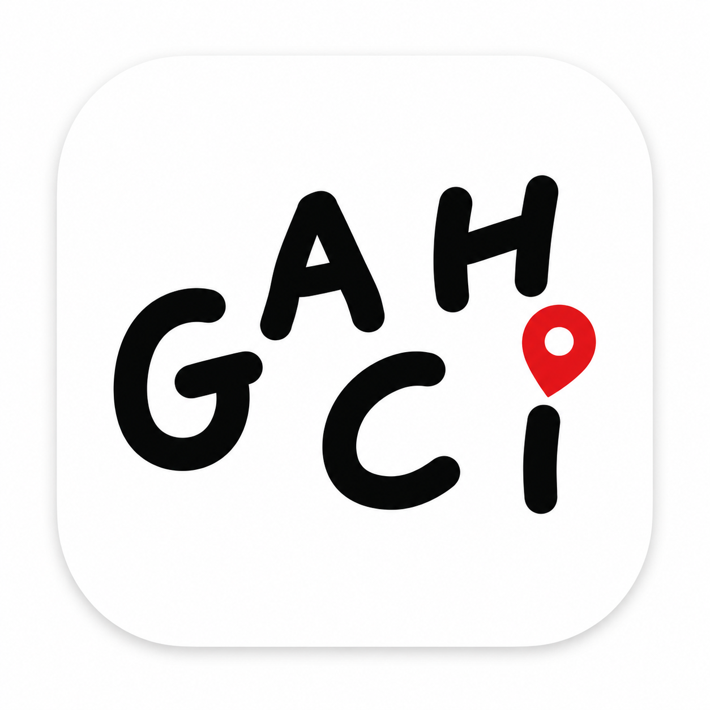
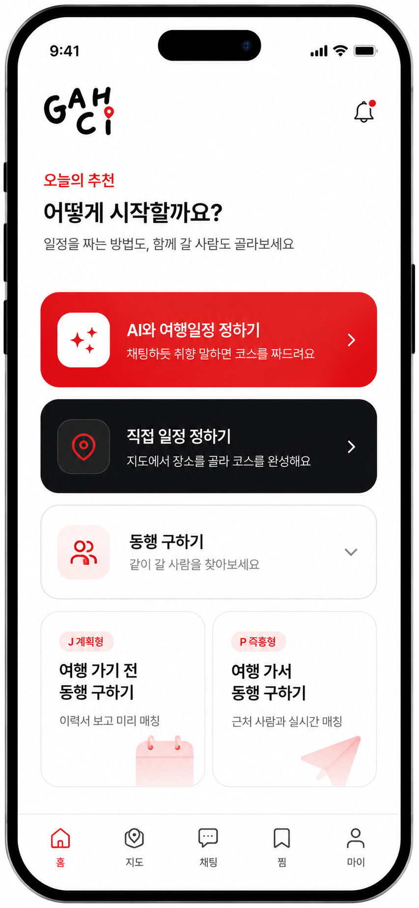
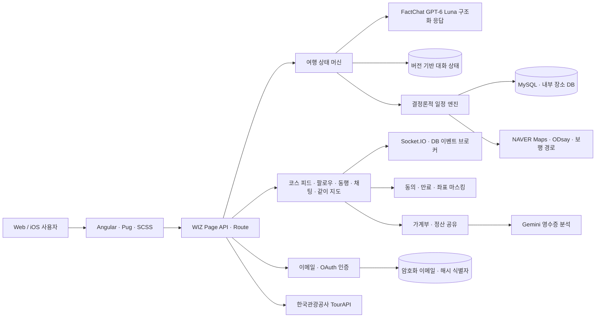
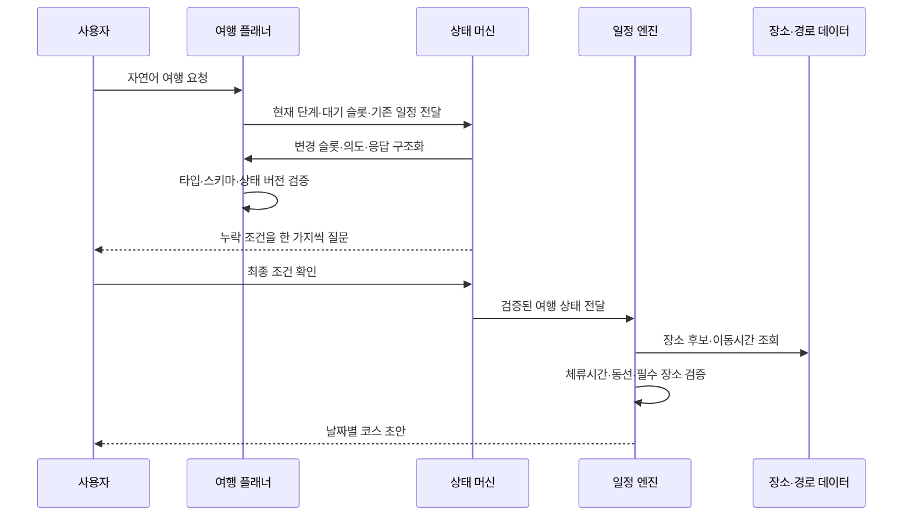

<p align="center">
  
</p>

<h1 align="center">GACHI</h1>

<p align="center">
  <strong>AI가 여행·데이트 계획을 만들고, 사람과 장소를 연결하며, 여행 중 길안내와 정산까지 이어주는 올인원 플랫폼</strong>
</p>

<p align="center">
  여행지 탐색부터 일정 생성, 코스 피드, 동행 매칭, 실시간 위치 공유와 여행 기록까지<br />
  흩어진 여행 경험을 하나의 코스 중심으로 연결했습니다.
</p>

<p align="center">
  <a href="https://travel.wizide.com/"></a>
  <a href="https://github.com/xericen/GACHI/actions/workflows/quality.yml"></a>
  
  
</p>

<p align="center">
  
</p>

## 프로젝트 한눈에 보기

| 항목 | 내용 |
|---|---|
| 서비스 | AI 여행·데이트 계획, 코스·동행·지도·채팅·정산 통합 플랫폼 |
| 형태 | 반응형 웹 서비스 + Capacitor 기반 iOS 앱 |
| 운영 주소 | [travel.wizide.com](https://travel.wizide.com/) |
| 핵심 사용자 | 여행 계획이 막막한 사용자, 함께 여행할 동행을 찾는 사용자 |
| 핵심 가치 | **계획부터 실행까지 끊기지 않는 여행 경험** |
| 주요 기술 | Angular, TypeScript, Python, WIZ Framework, MySQL, FactChat GPT-6 Luna, NAVER Maps, Socket.IO |

## 왜 만들었나요?

여행자는 보통 여러 서비스를 오가며 여행을 준비합니다.

- 검색 서비스에서 여행지를 찾고
- 메모나 스프레드시트로 일정을 정리하고
- 지도에서 이동 시간을 다시 계산하고
- 커뮤니티에서 동행을 구하고
- 메신저에서 약속과 위치를 공유합니다.

GACHI는 이 단절을 **여행 코스**라는 하나의 데이터로 통합했습니다. AI와 나눈 대화가 실제 일정이 되고, 확정한 일정이 동행 모집과 길안내, 같이 지도와 여행 기록으로 이어집니다.

```text
취향·조건 입력 → AI 일정 생성 → 코스 편집·피드 공유 → 작성자 팔로우·동행 매칭 → 길안내·위치 공유 → 채팅·정산
```

## 핵심 사용자 경험

### 1. 대화만으로 만드는 여행 일정

사용자가 여행지를 정하지 못했어도 출발지, 날짜, 동행, 이동수단, 일정 속도와 취향을 차례로 정리해 후보 지역과 코스를 제안합니다.

- `이번 주말`, `1박 2일`, `부모님과 함께` 같은 자연어 조건 해석
- 시작 위치와 숙소 위치를 분리해 첫 이동·숙소 복귀 시간 계산
- 도보 허용 시간, 휴식 빈도, 장소별 체류시간을 일정 밀도에 반영
- 생성 전 조건 확인, 생성 후 장소 줄이기·덜 걷기·식당 교체 지원
- `응`, `그대로 해줘`, `둘째 날만 바꿔줘` 같은 짧은 후속 발화를 현재 단계와 기존 일정 맥락으로 해석
- 날짜, 인원, 동행, 이동수단 등 슬롯별 타입을 검증하고 잘못된 AI 응답은 서버에서 차단
- 날짜·교통·숙소 조건을 필수 방문 장소로 오인하지 않도록 입력과 저장 상태를 정규화
- 비스트리밍 strict JSON Schema 응답으로 미변경 조건을 유지하고 인증·지연·불완전 응답 오류를 구분
- 첫 화면에서는 `오늘`, `내일`, `이번 주말`, `다음 주` 날짜 칩을 한 번에 전송하고, 대화 중에는 현재 대기 조건에 맞는 상황형 빠른 답변을 제공
- 후보 부족이나 외부 경로 실패 시 조건 완화 선택지로 복구

AI가 장소 이름과 일정을 자유롭게 만들어내지 않도록, 대화 해석과 일정 생성을 분리했습니다. FactChat Gateway의 `gpt-6-luna`는 현재 단계·대기 슬롯·답변한 조건·기존 일정 요약을 바탕으로 변경된 조건과 의도를 구조화하고, 서버 상태 머신과 결정론적 일정 엔진이 실제 장소 ID, 좌표, 체류시간과 이동 제약을 검증합니다. 대화 상태에는 버전을 부여해 동시에 들어온 오래된 요청이 최신 상태를 덮어쓰지 못하도록 보호합니다.

### 2. 직접 편집하고 다시 사용하는 코스

- 여행과 데이트 중 목적을 선택하고 유형·태그를 코스 데이터에 일관되게 저장
- 날짜별 장소 추가·삭제·순서 변경
- 여러 날짜를 `1일차`, `2일차`처럼 나누어 구성하고 마지막 일차에서만 게시
- 일차별 작업 내용을 임시 저장하고 다음 일차 구상으로 자연스럽게 연결
- 방문 시각, 체류시간, 이동수단과 메모 편집
- 공개 코스와 내 코스, 저장·보관한 코스를 분리 관리하고 보관·복원 지원
- 코스 원작자와 원본 ID를 보존한 공유·재사용
- 다른 사용자의 공개 코스를 작성자 중심 피드에서 탐색하고 작성자를 팔로우·해제
- 코스 이야기 상세에서 장소 순서와 위치를 NAVER 인앱 지도로 확인
- 코스별 동행 모집 유무를 표시하고 연결된 모집글만 필터링해 이동
- 공개 코스를 기반으로 동행 모집글 작성
- 장소 추가·삭제·메모 제안을 투표하고 작성자가 승인·거절하는 협업 흐름
- 코스 링크 공유·복사와 날짜별 일정의 ICS 캘린더 내보내기

### 3. 앱 안에서 끝나는 길안내

- NAVER Dynamic Map 기반 지도와 장소 좌표 표시
- NAVER Directions 5 자동차 실경로 및 대안 비교
- ODsay 대중교통 노선과 환승 정보, 제공자 실패 시 안전한 대체 경로
- 무료 보행 경로, 다음 회전까지 거리와 구간별 브라우저 음성 안내
- GPS 튐 완화, 경로 위 위치 보정, 진행 단계 자동 전환과 지속 이탈 시 재탐색
- 안내 중 현재 위치에서 다음 미도착 장소 한 곳만 표시하는 순차 길안내
- 다음 회전·거리, 현재 속도, 도착 예정 시각, 남은 거리 중심의 내비게이션 HUD
- 재중앙·나침반·음성 제어와 지원 브라우저의 화면 꺼짐 방지
- 경로 품질, 후보 급감, 외부 API 실패율과 생성시간 관측

### 4. 여행 전부터 여행 중까지 이어지는 동행

- 여행 이력서와 조건을 활용한 동행 신청·수락
- 확정 코스 기반 동행 준비방과 1:1 실시간 메시지
- 읽음, 입력 중, 재연결, 전송 실패 재시도 상태
- 마지막 메시지 시각을 한국 시간으로 표시하고 최근 대화 순으로 채팅방 자동 정렬
- 1:1 채팅 안에서 지출을 등록하고 참여자별 정산 결과를 `보내기`·`요청하기` 방향이 구분된 카드로 공유
- 지출 모달의 소형 카메라 버튼으로 영수증을 촬영하면 Gemini 비전 분석으로 상호명·항목·금액·분류를 입력 폼에 제안
- 여행 중 참가자 전용 위치 지도와 GPS 위치 공유, 드래그·확대/축소 시 끊기지 않는 반복형 지도 배경 제공
- 동행 목록 크기와 무관하게 접근 가능한 `신호 보내기` 버튼 제공
- 양쪽 동의, 30분·1시간·여행 종료 만료, 집·숙소 보호 구역 좌표 마스킹
- 차단·신고 저장 및 약속 종료 시 위치·채팅 상태 정리

### 5. 동행 신뢰도와 행동 기반 개인화

재계획 서버 로직은 강수·저장된 휴무·지연을 바탕으로 변경안을 생성하고, 방문 완료·고정 약속·다른 날짜를 보존하며 토큰·코스 지문으로 오래된 적용을 차단합니다. 현재 지도 안내 패널에서는 원터치 재계획·설정·복원 메뉴를 제거했으므로 해당 기능을 사용자 진입 기능으로 제공하지 않습니다.

- 확정된 동행 관계와 양쪽 방문 완료 기록을 확인한 뒤 후기 작성 허용
- 별점과 함께 표본 수·작성자 수·GPS 및 수동 방문 기록 근거 표시
- 저장·팔로우·실행 이력을 피드와 AI 후보 순위에 반영하고 개인화 끄기 설정 준수
- 알림 읽음·전체 읽음 상태를 서버에 저장하고 승인·거절 결과 전달

후기 근거는 서비스에 기록된 활동이며 실제 방문이나 안전의 독립적인 보증은 아닙니다. 재계획도 실시간 교통·임시 휴무를 보증하지 않으므로 적용 전 확인이 필요합니다.

### 6. 개인정보를 최소 노출하는 인증

- 이메일 로그인·회원가입을 기본 흐름으로 두고 Google·Kakao·Apple OAuth를 선택적으로 연결
- 이메일과 닉네임을 가입 전에 DB에서 중복 확인하고 최종 가입 시 서버와 고유 인덱스로 다시 검증
- 이메일 형식과 MX 레코드를 함께 확인해 메일 수신이 가능한 도메인만 가입 허용
- 이메일은 AES-256-GCM 암호문으로 저장하고 로그인 검색에는 HMAC-SHA256 해시 사용
- 소셜 공급자 식별자와 비교용 이메일도 원문 대신 서버 키 기반 해시로 저장
- OAuth access token·refresh token과 영수증 이미지는 서비스 DB에 저장하지 않음
- 계정 소유자와 승인된 관리자 응답에서만 필요한 이메일을 서버에서 복호화
- 요청 JWT를 기존 서버 세션보다 우선해 계정 전환 시 이전 사용자의 작성자 권한이 섞이지 않도록 보호
- 커뮤니티 삭제 권한은 서버가 판정한 작성자 여부만 신뢰하고 API에서 다시 검증

## 포트폴리오 핵심 구현

| 영역 | 해결한 문제 | 구현 내용 |
|---|---|---|
| AI 설계 | 대화형 AI의 조건 누락과 반복 질문 | 상태 컨텍스트, 슬롯 기반 상태 머신, 명시적 생성 확인, 응답 검증·복구 |
| AI 계약 | 모델별 JSON 편차와 프롬프트 충돌 | FactChat strict JSON Schema, nullable 미변경 슬롯, 서버 타입 검증 |
| 상태 동시성 | 여러 요청이 최신 대화를 덮어쓰는 문제 | 상태 버전과 compare-and-swap 저장, 충돌 관측 로그 |
| 일정 엔진 | 거리만 가까운 비현실적 코스 | 이동·체류시간, 시작점·숙소, 식사·필수 장소를 함께 최적화 |
| 여행 재계획 서버 로직 | 날씨·휴무·지연으로 기존 일정이 어려운 문제 | 변경안·토큰·지문 검증 구현 보존, 지도 진입 UI 제거 |
| 동행 신뢰·개인화 | 후기 근거와 추천 맥락 부족 | 확정 동행·완료 기록 검증, 근거·표본 수 표시, 행동 신호·옵트아웃 |
| 코스 소셜 피드 | 공개 코스 탐색과 작성자 관계가 분리된 문제 | 작성자 피드, 팔로우 저장, 코스별 동행 모집 필터, 상세 동선 지도 |
| 경로 품질 | 권역 점프·역방향·외부 API 실패 | 경로 품질 판정, 후보 교체, 다중 제공자 폴백, 운영 지표 |
| 실시간 길안내 | 정적인 경로선만으로 이동하기 어려운 문제 | 경로 투영, 턴 단계 전환, 이탈 재탐색, 음성 예고, HUD |
| 실시간 기능 | 채팅·위치 갱신의 지연과 중복 | Socket.IO 사용자 방, DB 이벤트 브로커, 메시지 ID 중복 제거 |
| 여행 정산 | 채팅과 별도 가계부를 오가는 불편 | 지출 입력, 참여자별 정산, 방향별 송금 카드, 영수증 비전 인식 |
| 위치 안전 | 정확한 좌표의 과도한 노출 | 상호 동의, 서버 만료, 보호 반경 마스킹, 차단·신고 |
| 위치 공유 UX | 동행 목록에 버튼이 가리고 지도 끝이 끊기는 문제 | 패널 기준 신호 버튼, 무한 반복 배경, 위치 전용 지도 안내 |
| 계정 보호 | DB 원문 개인정보와 소셜 식별자 노출 위험 | AES-GCM 암호화, HMAC 검색, 비식별 별칭, 관리자 권한 중복 검사 |
| 권한 일관성 | 계정 전환 뒤 이전 세션 권한이 남는 문제 | JWT 우선 식별, 잘못된 토큰 폴백 차단, 작성자 권한 서버 재검사 |
| 빌드 안정화 | WIZ 생성 작업공간의 의존성 누락 | Angular 20 빌드 어댑터와 의존성 자가복구 |
| 품질 관리 | 큰 통합 화면의 회귀 위험 | Python 계약 테스트, Playwright 모바일 E2E, GitHub Actions |
| 보안 | 키·비밀번호의 실수 커밋 | `.env` 분리, pre-commit 비밀정보 검사, 서버 전용 자격증명 |

## 여행의 분위기까지 담는 서비스

<table>
  <tr>
    <td width="33%"></td>
    <td width="33%"></td>
    <td width="33%"></td>
  </tr>
  <tr>
    <td align="center">산책과 휴식</td>
    <td align="center">자연과 전망</td>
    <td align="center">야경과 사진</td>
  </tr>
  <tr>
    <td width="33%"></td>
    <td width="33%"></td>
    <td width="33%"></td>
  </tr>
  <tr>
    <td align="center">카페와 감성</td>
    <td align="center">지역 음식</td>
    <td align="center">함께 만드는 여행</td>
  </tr>
</table>

## 시스템 구조



### AI 일정 생성 흐름



## 기술 스택

| 구분 | 기술 |
|---|---|
| Frontend | Angular 20, TypeScript, Pug, SCSS |
| Backend | Python, WIZ Framework Page/Route API |
| Database | MySQL, WIZ ORM, Node.js 운영 스크립트 |
| AI | FactChat Gateway · GPT-6 Luna 여행 채팅, Gemini 영수증 비전 분석, 상태 머신, 결정론적 일정 엔진 |
| Map & Route | NAVER Dynamic Map, Directions 5, ODsay, openrouteservice/OSM |
| Realtime | Socket.IO, 사용자별 방, DB 이벤트 브로커 |
| Identity | WIZ Session/JWT, OAuth 2.0, AES-256-GCM, HMAC-SHA256, PortOne 본인 인증 |
| Mobile | Capacitor 8, Swift iOS Shell, APNs, Universal Link |
| Quality | Python unittest, Playwright, npm audit, GitHub Actions |

## 숫자로 보는 프로젝트

| 지표 | 확인된 결과 |
|---|---:|
| 내부 장소 데이터 제공자 마이그레이션 | 19,754건 |
| Python 자동 회귀 테스트 | 223건 통과 · 2026-10-05 |
| 대표 여행 경로 품질 실측 | 성공 4개 코스 모두 `simple_route_ok=true` |
| 목 기반 모바일 브라우저 회귀 | 2026-10-05 재검증에서 기존 테스트와 현재 UI 불일치 확인 |
| npm 보안 감사 | 루트 14건 · moderate 2 / high 10 / critical 2 · 2026-10-05 |
| 원격 빌드 | GitHub Actions Quality·iOS 성공 |

Python 테스트와 루트 npm 감사는 2026-10-05 재검증 결과입니다. 장소 마이그레이션·경로 실측·원격 빌드 수치는 2026년 9월 개발 로그의 과거 검증 기록입니다. 외부 AI·경로 API 응답시간과 성공률은 제공자 상태 및 호출 시점에 따라 달라질 수 있습니다.

## 프로젝트 구조

```text
GACHI/
├── e2e/                       # 모바일 화면·동행·위치·채팅 E2E
├── mobile/                    # Capacitor iOS 프로젝트와 Xcode 배포 가이드
├── scripts/                   # DB 마이그레이션·장소 보강·만료 작업
├── src/
│   ├── angular/               # Angular/WIZ 빌드 어댑터
│   ├── app/page.access/       # 주요 UI·API·Socket.IO 컨트롤러
│   ├── assets/                # 브랜드·장소 이미지
│   ├── model/agents/          # 여행 상태 머신과 일정 엔진
│   ├── model/db/              # 장소·동행·채팅·위치·후기·협업·알림 모델
│   ├── model/ai_harness/      # FactChat 공급자·응답 계약·오류 복구
│   ├── model/travel_growth.py # 재계획 저장·후기 검증·행동 개인화
│   ├── model/travel_replan.py # 강수·휴무·지연 재계획 로직
│   ├── portal/                # WIZ 공통 모듈
│   └── route/                 # 지도·장소·관리 API
├── tests/                     # Python 자동 회귀 테스트
├── requirements.txt           # Python 런타임 의존성
├── playwright.config.ts       # 브라우저 E2E 설정
└── package.json               # 빌드·검증·운영 명령
```

## 로컬 실행과 검증

### 요구 사항

- Node.js 20 이상과 npm
- Python 3
- WIZ Framework 실행 환경
- MySQL 개발 데이터베이스
- iOS 검증 시 macOS와 Xcode

```bash
git clone git@github.com:xericen/GACHI.git
cd GACHI
npm ci
python -m pip install -r requirements.txt

cp .env.example .env
mkdir -p config
cp config-sample/database.py config/database.py
cp config-sample/ai.py config/ai.py
cp config-sample/auth.py config/auth.py
```

실제 API 키와 운영 설정은 `.env`와 `config/`에만 저장하며 Git에 커밋하지 않습니다.

### 주요 검증 명령

```bash
# Python 회귀 테스트
python -m unittest discover -s tests -p 'test_*.py'

# 민감정보와 의존성 취약점 검사
npm run secrets:check
npm audit --audit-level=low

# Playwright E2E
npm run test:e2e

# iOS 셸 검증
npm run mobile:verify
```

### 외부 연동 환경변수

| 변수 | 용도 | 노출 범위 |
|---|---|---|
| `TOUR_API_KEY` | 관광지·음식점·숙박 데이터 | 서버 전용 |
| `NAVER_MAPS_CLIENT_ID` | Dynamic Map·Geocoding | 허용 도메인 제한 |
| `NAVER_MAPS_CLIENT_SECRET` | Directions 5 | 서버 전용 |
| `ODSAY_API_KEY` | 대중교통 경로 | 서버 전용 |
| `OPENROUTESERVICE_API_KEY` | 보행 경로 | 서버 전용 |
| `FACTCHAT_API_KEY` / `BAZE_API_KEY` | FactChat 여행 채팅 인증 · `config/ai.py` 설정도 지원 | 서버 전용 |
| `GEMINI_API_KEY` | 영수증 비전 분석 | 서버 전용 |
| `GOOGLE_OAUTH_*` | Google 로그인 | 서버 전용 |
| `KAKAO_OAUTH_*` | Kakao 로그인 | 서버 전용 |
| `APPLE_OAUTH_*` | Apple 로그인 | 서버 전용 |
| `PORTONE_API_SECRET` | 본인 인증 결과 검증 | 서버 전용 |

## 품질과 보안

- 스테이징 파일의 API 키·토큰·비밀번호·개인키를 pre-commit에서 차단합니다.
- `.env`, `config/`, DB, 운영 로그, 업로드와 테스트 결과물은 Git에서 제외합니다.
- 사용자 이메일은 전용 버전 키로 AES-GCM 암호화하고, 검색용 해시와 공개용 비식별 값만 분리해 저장합니다.
- 회원가입 이메일은 형식과 MX 레코드를 검사하고, 이메일·닉네임 중복을 API와 DB 제약에서 이중 확인합니다.
- 소셜 공급자 원본 식별자와 토큰은 저장하지 않으며 회원 목록 API는 관리자 권한을 중복 확인합니다.
- JWT가 전달된 요청은 검증된 토큰 사용자를 우선하며, 유효하지 않은 토큰을 과거 서버 세션으로 대체하지 않습니다.
- 커뮤니티 글의 삭제 버튼과 API는 서버가 확인한 작성자에게만 허용됩니다.
- 영수증 이미지는 크기·형식을 검증한 분석 요청에만 사용하고 별도로 보관하지 않습니다.
- 사용자 위치는 참가자와 공개 기간을 서버에서 다시 검증합니다.
- 정확한 좌표는 상호 동의 상태에서만 제공하고 보호 구역에서는 마스킹합니다.
- Quality와 iOS GitHub Actions가 `main` 푸시마다 실행됩니다.

```bash
npm run hooks:install
git add <변경 파일>
npm run secrets:check:staged
git commit -m "feat: 변경 내용"
```

## 현재 제약과 다음 단계

기능을 빠르게 검증하는 과정에서 단일 WIZ 페이지에 여러 도메인이 모였고, 외부 제공자별 호출 방식도 각각 발전했습니다. 이를 숨기지 않고 원인·위험·완료 기준을 [아키텍처 개선 현황과 기술 부채 로드맵](ARCHITECTURE_IMPROVEMENTS.md)에 기록했습니다.

| 개선 축 | 현재 반영 | 다음 완료 기준 |
|---|---|---|
| 상태 분리 | 여행 도메인 상태와 요청/오류 상태 분리 | 플래너·위치·커뮤니티 store 단계적 추출 |
| 외부 API | 공통 결과·오류·재시도 가능 여부 계약 도입 | 모든 지도·장소·날씨 제공자 이전 |
| 경로 관측 | 품질 중앙값과 제공자별 요청·실패 집계 | 운영 대시보드·알림 채널 연결 |
| AI 신뢰 | 생성 근거, 품질 점수, 확인 필요 정보 표시 | 근거 데이터 시점과 제공자까지 확장 |
| 위치 정책 | 종료 즉시 좌표 제거, 동의 메타데이터 30일 삭제 | 실기기 장기 공유·삭제 작업 점검 |
| E2E | 생성 실패 복구, API 재시도, 근거 표시 검증 | 생성→수정→저장→실행 전체 여정 연결 |

- NAVER Directions 5는 자동차 경로 중심이므로 대중교통·보행은 별도 제공자와 대체 경로를 함께 운영합니다.
- 브라우저가 백그라운드 위치 실행이나 Screen Wake Lock을 제한하면 안내 지속을 보장할 수 없어 앱 복귀 시 위치를 재동기화합니다.
- 같이 지도는 참가자의 상대 위치를 공유하는 CSS 기반 위치 전용 화면이며, 실제 도로·건물 지도 타일이나 길찾기를 제공하지 않습니다.
- 웹 기반 위치 보정은 경로 선분 투영 방식이며 터널 추측 항법, 차선, 제한속도, 실시간 사고 정보는 별도 네이티브 SDK가 필요합니다.
- 다중 서버 확장 시 Socket.IO 세션 고정과 공유 어댑터 운영 구성이 필요합니다.
- iOS 실기기 푸시와 App Store 배포에는 Apple 서명 자격증명과 TestFlight 검증이 필요합니다.
- Google·Kakao·Apple 실제 로그인에는 각 공급자 콘솔의 Client ID·Secret·Redirect URI 등록이 필요합니다.
- 이메일 암호화 키를 분실하면 저장된 이메일을 복구할 수 없으므로 운영 키링의 안전한 백업과 교체 절차가 필요합니다.
- 영수증 인식 결과는 촬영 상태와 Gemini 응답에 따라 달라질 수 있어 등록 전 사용자 확인이 필요합니다.
- MX 검증은 이메일 도메인의 수신 가능성만 확인하며 개별 메일함 소유권까지 보장하지 않습니다.
- 실제 사용자 환경의 장기 위치 공유, 배터리 소모와 네트워크 전환 테스트를 계속 보강할 예정입니다.
- 루트 npm 감사에서 취약점 14건이 확인됐습니다. 의존성 패치·호환성 검증과 패치가 없는 전이 의존성 검토가 필요합니다.
- 휴무 감지는 저장된 날짜·요일 정보에 의존하며 임시 휴무를 보장하지 않습니다. 재계획과 동행 후기는 운영 실계정 다중 사용자 검증이 필요합니다.
- 오프라인 지도 팩은 현재 제공하지 않습니다. 코스 캐시와 실시간 경로 안내의 범위는 구분해야 합니다.

## 링크

- **Live**: [https://travel.wizide.com/](https://travel.wizide.com/)
- **Repository**: [https://github.com/xericen/GACHI](https://github.com/xericen/GACHI)
- **Contribution Guide**: [CONTRIBUTING.md](CONTRIBUTING.md)
- **Security Policy**: [SECURITY.md](SECURITY.md)

---

<p align="center">
  <strong>GACHI — 계획부터 동행, 이동과 기록까지 함께.</strong>
</p>
